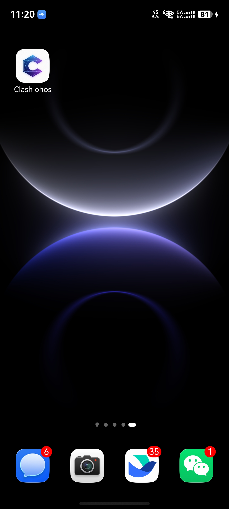
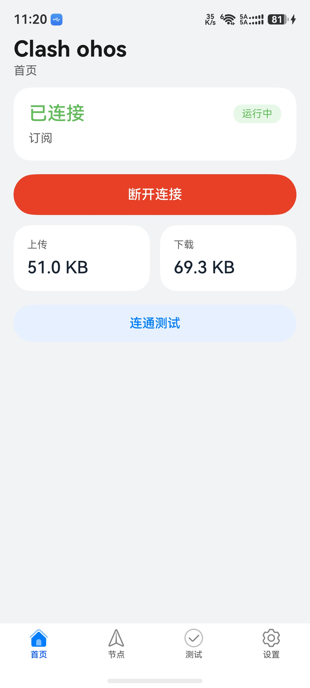
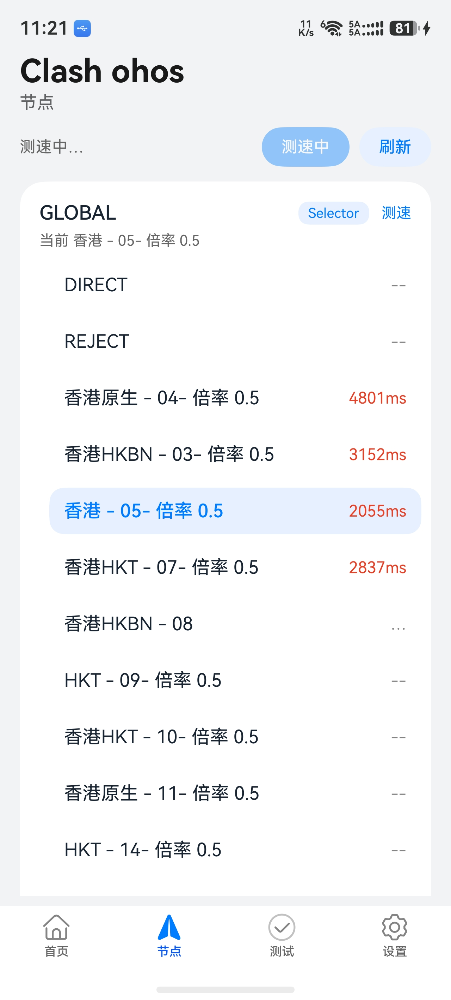
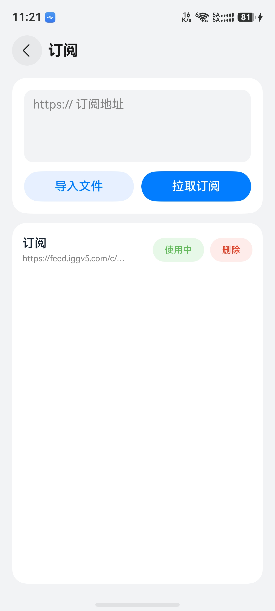
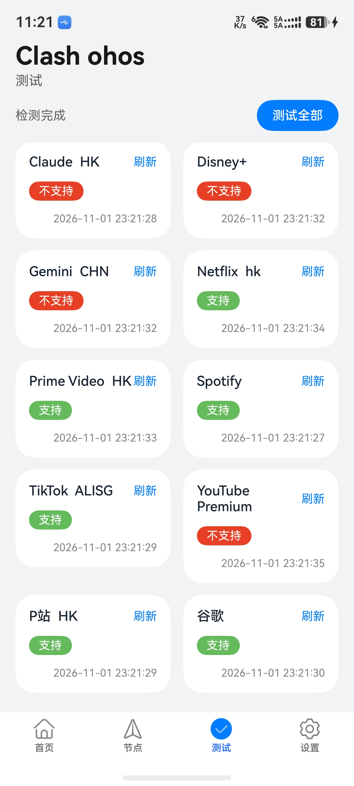
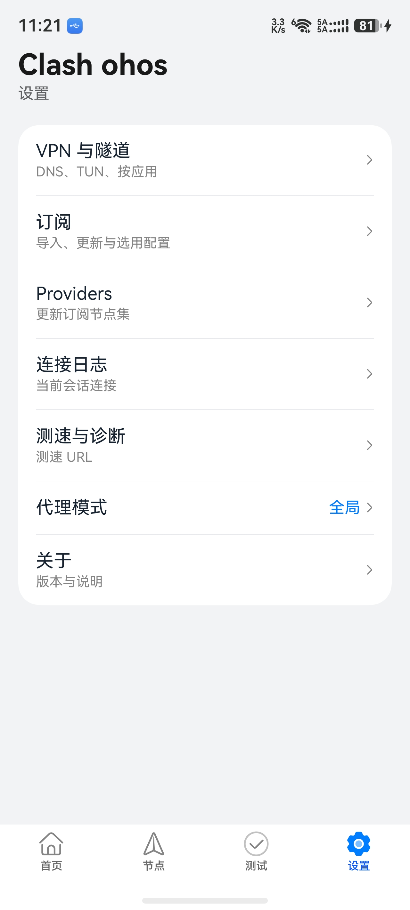
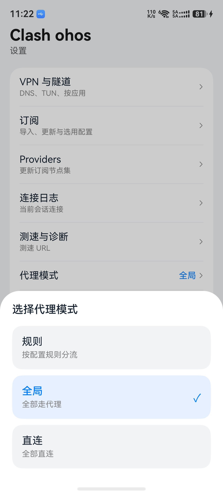

# ClashOhos

[](./LICENSE)
[](https://github.com/ls965526741/ClashOhos/releases)
[](https://developer.huawei.com/)

**ClashOhos** 是 HarmonyOS NEXT / 鸿蒙星河版上的 **Clash.Meta（mihomo）图形客户端**：系统 VPN 扩展加载核心，ArkUI 只走本机 REST。不提供节点、不运营机场。非 [MetaCubeX](https://github.com/MetaCubeX) 官方产品。

**ClashOhos** is an unofficial [Clash.Meta](https://github.com/MetaCubeX/mihomo) / mihomo GUI for **HarmonyOS NEXT**. The Go core runs only inside `VpnExtensionAbility`; the UI talks to `127.0.0.1` REST. GPL-3.0. You bring your own YAML / subscription.

| | |
|--|--|
| App | ClashOhos |
| Bundle | `com.clashohos.app` |
| Version | 0.1.0 (`versionCode` 100) |
| Core | mihomo 2.11.36 |
| OS | HarmonyOS NEXT API 6.0.2(22) |
| ABI | `arm64-v8a` (phone), `x86_64` (emulator) |
| License | GPL-3.0 |

**关键词 / keywords：** HarmonyOS NEXT、鸿蒙、Clash、Clash Meta、mihomo、VPN、代理客户端、ArkTS、HAP。

- [界面预览](#界面预览)
- [安装 HAP](#安装侧载-hap)
- [功能](#功能概览)
- [从源码构建](#从源码构建)
- [开源与合规](#开源与合规)
- [维护者：改包名](#维护者改包名)

---

## 界面预览

真机 HarmonyOS NEXT 截图（应用名显示为桌面图标文案；桌面图标见 `AppScope` 资源）。

| 桌面图标 | 首页（已连接） | 节点与测速 |
|:---:|:---:|:---:|
|  |  |  |
| 桌面入口 | 启停 VPN、上下行流量 | 策略组选节点、批量测速 |

| 订阅 | Unlock 检测 | 设置 |
|:---:|:---:|:---:|
|  |  |  |
| URL / 文件导入 YAML | 流媒体与站点连通 | VPN、订阅、Providers、日志 |

<p align="center">
  
</p>

<p align="center"><sub>设置 → 代理模式：规则分流、全局代理或全部直连</sub></p>

---

## 功能概览

- 系统 VPN 隧道 + TUN（mixed / gvisor / system 栈）
- 订阅 URL / 本地 YAML 导入、切换配置
- 策略组选节点、测速、代理模式、Providers 更新
- 设置：IPv6、DNS、按应用白/黑名单、测速 URL、会话记忆
- Unlock 检测、连接列表与流量（REST）

详见 [`VERIFICATION.md`](./VERIFICATION.md)、[`PRIVACY.md`](./PRIVACY.md)、[`G13-RELEASE.md`](./G13-RELEASE.md)。

---

## 安装（侧载 HAP）

### 方式 A：GitHub Releases（推荐）

1. 打开仓库 **Releases**，下载 `clash-ohos-0.1.0-*-signed.hap`（或当前 `versionName`）。
2. 将 HAP 传到手机（USB、华为分享等）。
3. 在手机上用 **文件管理** 打开 HAP，或使用 DevEco **Device Manager** 安装：

   ```powershell
   hdc install clash-ohos-0.1.0-signed.hap
   ```

4. 首次打开：在 **设置 → 订阅** 导入配置并「使用」，回首页连接 VPN，在系统弹窗中允许 VPN。

> 当前 Release 使用 **DevEco 自动签名 / debugKey**，仅供个人侧载与测试。上架华为应用市场需联盟 **VPN 受限能力** 与正式发布证书，见 [`G13-RELEASE.md`](./G13-RELEASE.md)。

### 方式 B：自行编译

见下文 [从源码构建](#从源码构建)。

### 系统要求

- HarmonyOS NEXT 真机或模拟器（建议真机 `arm64-v8a`）
- 需自行准备 **订阅或 YAML**；应用不提供任何节点

---

## 从源码构建

### 1. 工具链

| 工具 | 说明 |
|------|------|
| **Git 子模块** | `git submodule update --init --recursive`（拉取 `core/` 内 mihomo 源码，编译 `libclash.a` 必需） |
| [DevEco Studio](https://developer.huawei.com/consumer/cn/deveco-studio/) 或 Command Line Tools | 含 HarmonyOS SDK API 22 |
| OpenHarmony **NDK / LLVM** | 随 SDK 安装 |
| **Go**：OHOS 用 [openharmony/go](https://gitee.com/openharmony-sig/tpc_go) 构建 `arm64`；主机用 stock Go 构建 `x86_64` |
| 本仓库 **Android 侧 `core/`** | 用于编译 `libclash.a` |

环境变量（路径按本机修改）：

```powershell
$env:DEVECO_SDK_HOME = "D:\software\harmonyos\command-line-tools\sdk"
# 若 DevEco 编译报 SDK 不一致，改为 DevEco 安装目录下的 sdk
# $env:DEVECO_SDK_HOME = "D:\software\harmonyos\DevEco Studio\sdk"
$env:PATH = "D:\software\harmonyos\command-line-tools\hvigor\bin;" + $env:PATH
```

### 2. 签名配置（勿提交密钥）

```powershell
cd harmony
copy build-profile.json5.example build-profile.json5
# 在 DevEco 中 File → Project Structure → Signing Configs 生成调试证书，或填入已有 .p12/.p7b/.cer 路径
```

`build-profile.json5` 已列入 `.gitignore`，**不要**把密码推送到 GitHub。

### 3. 编译 Go 核心（`libclash.a`）

仓库默认 **不** 提交 `prebuilt/*.a`（体积大、可复现构建）。首次构建前执行：

```powershell
# 编辑 harmony\scripts\build-libclash-ohos.ps1 中的 Go / SDK / LLVM 路径
.\harmony\scripts\build-libclash-ohos.ps1
```

产物：

- `harmony/entry/src/main/cpp/prebuilt/arm64-v8a/libclash.a`
- `harmony/entry/src/main/cpp/prebuilt/x86_64/libclash.a`

### 4. 编译 HAP

```powershell
cd harmony
hvigorw assembleHap -p product=default -p buildMode=release
```

输出（默认）：

`entry/build/default/outputs/default/entry-default-signed.hap`

打包 Release 附件（可选）：

```powershell
.\harmony\scripts\package-github-release.ps1 -Version 0.1.0
```

---

## 开源与合规

完整说明见 [`OPEN_SOURCE.md`](./OPEN_SOURCE.md)。摘要：

- 本仓库基于 [Clash Meta for Android](https://github.com/MetaCubeX/ClashMetaForAndroid)（**GPL-3.0**）与 [mihomo](https://github.com/MetaCubeX/mihomo)（**GPL-3.0**）。
- **分发 HAP 二进制**时，须向用户提供 **对应完整源码**（本 Git 仓库 + 子模块/依赖说明即可），并保留 [`NOTICE.md`](./NOTICE.md) 与根目录 [`LICENSE`](../LICENSE)。
- **华为 HarmonyOS SDK** 受华为许可约束，**不得**随仓库再分发 SDK；使用者需自行安装 DevEco / CLI。
- 应用仅作 **本地 VPN 客户端**；用户自行承担订阅内容与当地法规合规责任。
- 商标：**Clash** / **MetaCubeX** 归各自权利人；本项目名称 **ClashOhos** 为社区移植，非官方应用。

---

## 目录结构

```
harmony/
  entry/                 # HAP 模块（ArkUI + NAPI + VPN 扩展）
  scripts/               # libclash 与 Release 打包脚本
  PLAN.md                # 架构计划（v2）
  VERIFICATION.md        # 真机门禁记录
```

Android 原版 UI 与 Gradle 工程在仓库根目录；Harmony 移植仅依赖 `core/` 与 `harmony/`。

---

## 发布 GitHub Release

1. 打 tag：`v0.1.0`（与 `AppScope/app.json5` 中 `versionName` 一致）。
2. GitHub → **Releases → Draft a new release**，选择该 tag。
3. 填写说明（可参考 [`release/RELEASE_NOTES.md`](./release/RELEASE_NOTES.md)）。
4. 上传 `harmony/release/clash-ohos-0.1.0-signed.hap`（由 `package-github-release.ps1` 生成）。
5. **Source code**：GitHub 会自动附带 tag 的 zip/tar.gz；确保 tag 指向含 `harmony/` + `core/` + 构建脚本的提交。

未安装 `gh` CLI 时可在网页完成；安装后可执行：

```powershell
git tag v0.1.0
git push origin v0.1.0
gh release create v0.1.0 `
  --title "ClashOhos 0.1.0" `
  --notes-file harmony/release/RELEASE_NOTES.md `
  harmony/release/clash-ohos-0.1.0-signed.hap
```

---

## 反馈

Issue 请说明：设备型号、HarmonyOS 版本、是否已连接 VPN、hilog 片段（过滤 `ClashOhos` / `libclash`）。

---

## 维护者：改包名

HarmonyOS 的 **bundleName** 以 `AppScope/app.json5` 为准，代码里通过 `Constants.ets` 的 `BUNDLE_NAME` 启动 VPN 扩展（须与前者一致）。**应用显示名** 用 `APP_NAME`，并与各 `string.json` 里的 `app_name` 等保持一致。

| 必改 | 文件 |
|------|------|
| 应用显示名 | `Constants.ets` → `APP_NAME`；`AppScope` / `entry` 下 **base、zh_CN、en_US** 的 `string.json` |
| 应用包名 | `AppScope/app.json5` → `bundleName`、`vendor` |
| 运行时 | `Constants.ets` → `BUNDLE_NAME` |
| 关于 / 标题 | `About.ets`、`Index.ets`（已用 `APP_NAME`） |
| 文案 | `README.md`、`PRIVACY.md`、`G13-RELEASE.md` 等 |

改包名后：卸载旧 HAP；在 DevEco **Signing Configs** 为新包名重新生成 `.p7b`；再编译安装。详见 [`docs/SIGNING.md`](./docs/SIGNING.md)。

`module.json5` 里的 Ability 名称（如 `ClashVpnExtensionAbility`）不必随包名改。
